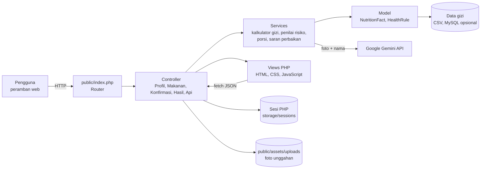
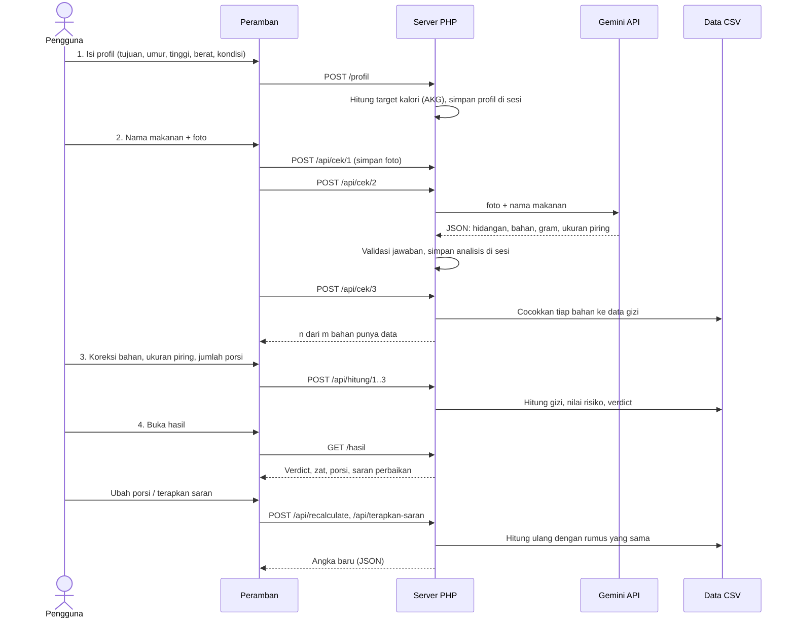

# CekPiring

Aplikasi web untuk **LOGICODIX 2026**, subtema **Inclusive Health & Well-being**, kategori **Web**.

CekPiring membantu orang yang harus menjaga makan (diabetes, hipertensi, kolesterol tinggi, asam urat) atau yang punya target kebugaran (cutting, bulking, seimbang) untuk menjawab satu pertanyaan sebelum makan: **"Apakah piring ini aman untukku, dan apa yang bisa kuubah?"**

Pengguna memotret makanan dan mengetik namanya. Aplikasi menebak bahan di piring, pengguna memastikannya, lalu CekPiring menghitung gizi dan risikonya sesuai profil kesehatan pengguna, memberi saran porsi, dan menunjukkan perubahan konkret beserta efeknya pada angka.

> Estimasi edukatif. CekPiring bukan alat diagnosis dan bukan pengganti saran dokter atau ahli gizi.

## Informasi tim dan proyek

| | |
|---|---|
| **Lomba** | LOGICODIX 2026 |
| **Subtema** | Inclusive Health & Well-being |
| **Kategori** | **Web** |
| **Nama aplikasi** | **CekPiring** |
| **Nama tim** | **apaaa ya linn** |
| **Institusi** | Universitas Negeri Maulana Malik Ibrahim Malang |
| **Repositori** | https://github.com/faturrahman82/logicodix-CekPiring |

### Anggota tim

| Nama | NIM | Program studi | Akun GitHub | Peran |
|---|---|---|---|---|
| **Maulvi Ilmullah Faturrahman Al Afghani** (ketua) | 240605110114 | S1 Teknik Informatika | `faturrahman82` | Project manager; data gizi, logika perhitungan, integrasi AI, dokumentasi |
| **Ari Pratama** | 250605110199 | S1 Teknik Informatika | `aripratama1234ari-droid` | Perbaikan galat halaman cek bahan dan hasil |
| **Ulinnuha Mahbubi** | 250605110178 | S1 Teknik Informatika | `B1bub0b` | Kerangka aplikasi PHP MVC dan integrasi awal Gemini |
| **Devita Aulia Putri** | 250605110013 | S1 Teknik Informatika | `putxy1` | Tampilan antarmuka, loader, dan perbaikan responsif |

Rincian kontribusi per orang ada di [Kontribusi tim](#kontribusi-tim).

## Masalah, solusi, dan target pengguna

**Masalah yang diangkat.** Orang dengan diabetes, hipertensi, kolesterol tinggi, atau asam urat harus memilih makanan setiap hari, tetapi sulit menebak isi masakan, terutama kuah, santan, bumbu, garam, dan gula. Aplikasi hitung kalori umum berhenti di angka kalori dan tidak menilai apakah makanan itu aman untuk kondisi tertentu. Dalam survei kebutuhan pengguna tim terhadap 32 responden, 72% sulit menebak komposisi kuah dan bumbu, dan 97% menginginkan fitur yang memperingatkan risiko.

**Solusi.** CekPiring menjawab "apakah piring ini aman untukku dan apa yang bisa kuubah?" dalam empat langkah: profil kesehatan, foto dan nama makanan, konfirmasi bahan, lalu hasil. AI mengenali makanan dari foto, sedangkan semua angka gizi dan penilaian risiko dihitung kode dari data resmi sehingga bisa ditelusuri. Aplikasi juga menyarankan porsi dan perubahan bahan beserta efeknya pada angka.

**Target pengguna.**
- Penderita atau orang yang berisiko diabetes, hipertensi, kolesterol tinggi, dan asam urat.
- Orang yang punya target kebugaran (cutting, bulking, atau menjaga berat) dan ingin tahu isi piringnya.
- Keluarga atau pendamping yang menyiapkan makanan untuk orang dengan kondisi di atas.

## Daftar isi

1. [Informasi tim dan proyek](#informasi-tim-dan-proyek)
2. [Masalah, solusi, dan target pengguna](#masalah-solusi-dan-target-pengguna)
3. [Fitur utama](#fitur-utama)
4. [Alur penggunaan](#alur-penggunaan)
5. [Langkah 1: Profil](#langkah-1-profil)
6. [Langkah 2: Makanan](#langkah-2-makanan)
7. [Langkah 3: Cek bahan](#langkah-3-cek-bahan)
8. [Langkah 4: Hasil](#langkah-4-hasil)
9. [Cara perhitungan](#cara-perhitungan)
10. [Peran AI dan kode](#peran-ai-dan-kode)
11. [Data dan sumber](#data-dan-sumber)
12. [Teknologi, arsitektur, dan struktur proyek](#teknologi-yang-digunakan)
13. [Cara menjalankan](#cara-menjalankan)
14. [Keamanan dan privasi](#keamanan-dan-privasi)
15. [Keterbatasan yang diketahui](#keterbatasan-yang-diketahui)
16. [Kontribusi tim](#kontribusi-tim)
17. [Sumber dan atribusi](#sumber-dan-atribusi)

## Fitur utama

- **Pengenalan makanan dari foto dan nama** memakai AI (Google Gemini): hidangan, bahan, perkiraan gram, dan ukuran piring.
- **Konfirmasi bahan oleh pengguna**: bahan bisa diedit, dihapus, atau ditambah sebelum dihitung. Bila nama dan foto tidak cocok, pengguna memilih salah satu.
- **Perhitungan gizi yang transparan**: semua angka dihitung kode dari data resmi, bukan ditulis AI.
- **Penilaian sesuai kondisi kesehatan**: batas harian berbeda untuk diabetes, hipertensi, kolesterol tinggi, dan asam urat.
- **Porsi disarankan**: "makan sekitar 0,5 piring" lengkap dengan perbandingan angka.
- **Perbaiki piringmu**: saran mengurangi atau mengganti bahan, dihitung ulang sehingga efeknya terlihat (misalnya "Gula 128% → 48% batas harian").
- **Data yang jujur**: bahan tanpa data ditandai "data belum tersedia" dan tidak dihitung sebagai nol.
- **Loader dengan langkah nyata**: tiga langkah pemeriksaan dicentang hanya setelah server benar-benar menyelesaikannya.

## Alur penggunaan

```
Profil  →  Makanan (foto + nama)  →  Cek bahan  →  Hasil
 (1)              (2)                  (3)          (4)
```

Indikator langkah (1 sampai 4) tampil di bagian atas setiap halaman. Tombol "Analisis makanan lain" di hasil mengulang dari profil.

## Langkah 1: Profil

Halaman pertama menanyakan siapa penggunanya, supaya target kalori dan batas gizi sesuai orangnya. Data hanya disimpan di sesi peramban pengguna (sesi PHP di server), tidak ada akun, kata sandi, atau basis data pengguna.

### Tujuan utama

Pengguna memilih satu dari tiga tujuan. Tujuan hanya mengubah **target kalori harian**:

| Tujuan | Arti | Pengaruh pada target kalori |
|---|---|---|
| **Cutting** | Menurunkan lemak | dikurangi 15% |
| **Seimbang** | Menjaga berat badan | sama dengan kebutuhan harian |
| **Bulking** | Menambah massa otot | ditambah 15% |

Angka 15% adalah aturan tim, belum bersumber pedoman resmi.

### Data fisik

| Kolom | Rentang yang diterima |
|---|---|
| Jenis kelamin | laki-laki atau perempuan |
| Umur | 1 sampai 120 tahun |
| Tinggi | 50 sampai 250 cm |
| Berat | 20 sampai 300 kg |

- Saat menekan **Simpan profil**, ketiga angka (umur, tinggi, berat) wajib diisi dan harus berupa angka wajar. Jika tidak, muncul pesan dan profil tidak tersimpan. Kolom hanya menerima angka.
- Pratinjau target kalori tampil langsung saat pengguna mengetik.

### Kondisi kesehatan

Empat pilihan yang bisa dicentang bersamaan (boleh kosong):

| Kondisi | Zat yang dipantau lebih ketat |
|---|---|
| **Diabetes** | Gula |
| **Hipertensi** | Natrium |
| **Kolesterol tinggi** | Lemak jenuh |
| **Asam urat tinggi** | Purin |

Kondisi yang dicentang menentukan zat mana yang dijadikan fokus di halaman hasil, batas harian yang dipakai, dan isi verdict. Pilihan ini bukan diagnosis.

### Target harian

Target kalori dihitung dari **Angka Kecukupan Gizi (AKG) Kemenkes, Permenkes No. 28 Tahun 2019**, sesuai umur dan jenis kelamin (tabel di `data/akg_2019.csv`), lalu disesuaikan tujuan (±15%).

Contoh: perempuan 45 tahun, tujuan Cutting → AKG 2.150 kkal × 0,85 = 1.828 kkal.

Jika data fisik lengkap, layar profil juga menampilkan **perkiraan pribadi** dari rumus Mifflin-St Jeor (dari tinggi dan berat, aktivitas ringan, ×1,375) sebagai pembanding. Angka utama yang dipakai tetap AKG.

Keterbatasan: tabel AKG yang tercatat mulai umur 10 tahun. Untuk umur di bawah itu, aplikasi memakai target umum 2.000 kkal.

### Tombol "Lewati, pakai target umum"

Pengguna yang tidak ingin mengisi profil bisa menekan tombol ini. Akibatnya:

- target kalori **2.000 kkal per hari**;
- tujuan otomatis **Seimbang** (pilihan tujuan sebelumnya diabaikan);
- jenis kelamin diisi perempuan sebagai nilai bawaan, data fisik kosong;
- **semua kondisi kesehatan dianggap tidak ada**, walaupun sempat dicentang, sehingga yang dipakai batas harian umum.

## Langkah 2: Makanan

Pengguna mengisi:

1. **Nama makanan** (maksimal 100 karakter), misalnya "Sayur sop" atau "Ayam geprek".
2. **Foto makanan**: JPG, PNG, atau WEBP, maksimal 5 MB. Tombol baru aktif setelah nama dan foto terisi.

Menekan **Cek bahan makanan** menjalankan tiga langkah nyata. Setiap langkah dicentang setelah server menyelesaikannya, dengan hasil asli di bawahnya:

| Langkah | Yang dikerjakan | Contoh hasil |
|---|---|---|
| 1. Mengunggah foto makanan | Validasi tipe dan ukuran, lalu simpan | "Foto diterima (13 KB)" |
| 2. Mendeteksi bahan dari foto dengan AI | Panggilan ke Gemini, atau resep contoh bila AI tidak aktif | "Dikenali AI: Sayur sop, 9 bahan" |
| 3. Mencocokkan bahan dengan data gizi | Pencocokan tiap bahan ke data | "7 dari 9 bahan punya data gizi" |

Langkah 2 paling lama (sekitar 10 detik dengan Gemini). Bila ada langkah yang gagal, langkah itu ditandai merah dengan pesan penyebabnya. Tanpa JavaScript, form tetap bekerja lewat pengiriman biasa.

## Langkah 3: Cek bahan

Halaman ini memastikan bahan sebelum dihitung.

- **Foto dan nama hidangan**, dengan label sumber: "Dikenali AI dari foto dan nama" atau "Resep contoh, belum dari foto".
- **Konflik nama dan foto**: jika nama yang diketik berbeda dengan isi foto (misalnya "Sate ayam" tetapi fotonya sayur sop), muncul banner dengan dua pilihan, **Pakai nama** atau **Pakai foto**.
- **Ukuran piring** (Kecil, Sedang, Besar): ditebak AI dari foto, dengan alasan singkat. Bila pengguna menggantinya, gram semua bahan ikut berubah (×0,7, ×1,0, ×1,3) dan total tampil langsung.
- **Daftar bahan**: tiap bahan menampilkan gram, perkiraan kalori, sumber data (misalnya "TKPI 2017"), dan tingkat kelengkapan data (Lengkap/Sebagian). Bahan bisa **diedit** (jumlah dengan satuan g, ml, butir, sdm, sdt, potong, buah, siung, lembar, mangkuk, tusuk), **dihapus**, atau **ditambah** lewat pencarian.
- **Bahan tanpa data** diberi label "Belum ada data" dan tidak ikut dihitung.
- **Berapa piring dimakan**: 0,5 sampai 3 dengan kelipatan 0,5. Total gram dan kalori berubah langsung.

Menekan **Hitung estimasi gizi** menjalankan tiga langkah nyata lagi:

| Langkah | Yang dikerjakan | Contoh hasil |
|---|---|---|
| 1. Mencocokkan bahan dengan data komposisi | Simpan bahan dan porsi, cocokkan ke data | "2 dari 3 bahan punya data gizi" |
| 2. Menghitung energi dan makro per porsi | Hitung gizi | "544 kkal, protein 33 g, lemak 45 g, karbo 0 g" |
| 3. Menyesuaikan profil kesehatan dan batas aman | Nilai risiko dan verdict | "Hati-hati, natrium tertinggi 85%" |

## Langkah 4: Hasil

Halaman hasil dibuat singkat. Urutan isinya:

1. **Judul dan ringkasan**: nama hidangan, ukuran piring dan sumbernya, jumlah piring, total gram, serta kondisi kesehatan yang aktif.
2. **Verdict** (Cocok, Cukup cocok, atau Hati-hati) dengan satu kalimat alasan.
3. **Porsi dimakan**: tombol − dan +, serta tombol **Pakai porsi disarankan (0,5)** dan baris perbandingan (misalnya "Natrium: 1 piring 58% → 0,5 piring 29%"). Mengubah porsi memperbarui semua angka, dan porsi tersimpan.
4. **Zat yang dipantau**: natrium, gula, lemak jenuh, dan purin dengan angka, persen batas harian, level (Rendah, Sedang, Tinggi), dan penyumbang terbesar. Zat dari kondisi yang dicentang tampil di atas, sisanya dilipat sebagai informasi. Zat tanpa data tampil "Data bahan belum tersedia".
5. **Kalori dan makronutrien**: cincin energi, persen dari target harian, sisa kebutuhan, serta karbohidrat, protein, dan lemak.
6. **Perbaiki piringmu**: maksimal tiga saran (misalnya "Ganti daging ayam dengan dada ayam tanpa kulit: Lemak jenuh 102% → 42% batas harian"). Tiap saran punya tombol **Terapkan**, dan tombol **Batalkan semua** mengembalikan bahan awal. Angka, bar, dan verdict bergerak ke nilai baru, dengan ringkasan perubahan.
7. **Satu kalimat saran** dari zat tertinggi, misalnya "Untuk hipertensi dan kolesterol tinggi, lemak jenuh paling tinggi (262% batas harian), terutama dari santan dan daging ayam."
8. **Lihat rincian bahan dan sumber** (dilipat): tabel gram dan kalori per bahan, serta sumber data.

## Cara perhitungan

### Gizi

```
nilai gizi = (nilai per 100 g ÷ 100) × gram bahan × jumlah piring
```

Totalnya dijumlahkan dari semua bahan yang punya data. Bahan yang datanya kosong untuk suatu zat tidak menambah zat itu, dan hasilnya diberi catatan "data sebagian bahan".

### Batas harian

| Zat | Umum (kondisi tidak dicentang) | Kondisi dicentang | Sumber |
|---|---|---|---|
| Natrium | 2.000 mg | 1.500 mg (hipertensi) | Permenkes 30/2013; American Heart Association |
| Gula | 50 g | 5% energi (diabetes) | Permenkes 30/2013; Persagi/PERKENI |
| Lemak jenuh | di bawah 10% energi | di bawah 7% energi (kolesterol tinggi) | WHO; PERKI 2022 |
| Purin | tidak dinilai (hanya informasi) | 400 mg (asam urat) | pedoman gout Jepang (Kaneko 2014) |

Batas gula dan lemak jenuh dihitung dari **target kalori pengguna** (gula: 5% energi ÷ 4 kkal/g; lemak jenuh: 7% atau 10% energi ÷ 9 kkal/g). Sebagian angka dikutip dari sumber sekunder dan perlu dicocokkan ke dokumen pedoman aslinya sebelum dipakai secara formal.

### Level risiko

Level dihitung dari persen terhadap batas harian untuk **satu waktu makan**:

| Persen batas harian | Level |
|---|---|
| di bawah 20% | Rendah |
| 20% sampai 33% | Sedang |
| di atas 33% | Tinggi |

Sepertiga batas harian dipakai sebagai plafon sekali makan.

### Verdict

- **Ada kondisi dicentang**: ditentukan zat terburuk dari kondisi itu. Di atas 33% → **Hati-hati**, 20% sampai 33% → **Cukup cocok**, di bawah 20% → **Cocok**. Bila data zat itu tidak tersedia → **Belum bisa dinilai**, dengan catatan.
- **Tanpa kondisi**: bila ada zat di atas 33% batas umum → **Cukup cocok**. Bila tidak ada, dinilai dari kalori (di atas 40% target harian → Cukup cocok, selain itu Cocok). Verdict tanpa kondisi tidak pernah "Hati-hati".

### Porsi disarankan

```
porsi disarankan = 33% ÷ persen terburuk
```

Dari zat kondisi yang dicentang, dihitung untuk satu piring, dibulatkan **ke bawah** per 0,1 supaya benar-benar di bawah 33%, dengan batas minimal 0,3 dan maksimal 1. Tanpa kondisi, porsi disarankan selalu 1.

### Perbaiki piringmu

Untuk setiap zat yang tinggi (di atas 33%, atau di atas 20% bila zat itu dari kondisi yang dicentang), kode mencoba dua aksi:

1. **Kurangi**: bahan penyumbang terbesar dikurangi setengahnya.
2. **Ganti**: bahan diganti pengganti yang lebih ringan dari daftar tetap (minyak sawit ke minyak kedelai, mentega ke margarin, susu kental manis ke susu sapi, ayam berkulit ke dada ayam tanpa kulit), hanya bila pengganti punya data untuk zat itu.

Setiap aksi dihitung ulang dengan kalkulator dan batas yang sama, lalu dipilih yang paling menurunkan zat itu. Aksi yang sama untuk beberapa zat digabung jadi satu saran. Bila setelah penggantian ada zat lain yang naik (misalnya purin pada dada ayam), angkanya tetap ditampilkan apa adanya.

## Peran AI dan kode

### Layanan AI yang dipakai

| Layanan | Model | Bagian produk yang memanfaatkannya |
|---|---|---|
| **Google Gemini API** (`generativelanguage.googleapis.com`, Google AI Studio) | `gemini-3-flash-preview` (bawaan, dapat diganti lewat `GEMINI_MODEL`). Model cadangan bila gagal: `gemini-3.1-flash-lite` | **Langkah 2 (Makanan)**: mengenali hidangan dari foto dan nama, menebak bahan beserta gramnya, menebak ukuran piring, dan mendeteksi nama yang tidak cocok dengan foto. Dipanggil dari `app/Services/AiClient.php` melalui `/api/cek/2` |

AI hanya dipakai di bagian itu. Tidak ada AI lain di aplikasi.

### Pembagian tugas

| Tugas | Siapa |
|---|---|
| Mengenali hidangan dari foto dan nama | **AI (Google Gemini)** |
| Menebak bahan dan perkiraan gram | **AI**, hanya memilih nama bahan dari daftar 80-an nama yang sudah dipastikan punya data gizi |
| Menebak ukuran piring | **AI** |
| Mendeteksi nama dan foto yang tidak cocok | **AI** |
| Semua angka gizi, persen batas, level, verdict | **Kode PHP** dari data CSV |
| Porsi disarankan dan saran "Perbaiki piringmu" | **Kode PHP** |
| Kalimat saran dan teks hasil | **Kode PHP** (templat dari angka yang dihitung) |

AI **tidak diminta menyebut angka gizi**, dan angka gizi dari AI bila ada akan diabaikan. Jadi setiap angka di hasil bisa ditelusuri ke sumber data dan hasilnya sama untuk input yang sama.

**Detail penggunaan Gemini**
- Model dibaca dari `GEMINI_MODEL`. Urutan percobaan: model di `GEMINI_MODEL`, lalu `gemini-3-flash-preview`, lalu `gemini-3.1-flash-lite`.
- Yang dikirim ke Gemini hanya **foto dan nama makanan**. Profil dan kondisi kesehatan pengguna tidak dikirim.
- Jawaban diminta berupa JSON dan divalidasi: nama bahan wajib ada, berat 1 sampai 1.000 g, maksimal 15 bahan, ukuran piring salah satu dari kecil, sedang, atau besar.
- Kunci API dikirim lewat header (bukan di URL), dan verifikasi SSL aktif.

**Tanpa kunci API atau bila Gemini gagal**: aplikasi memakai resep contoh yang tertanam (sekitar 19 hidangan, di `AiClient`) dan memberi label "Resep contoh, belum dari foto". Hidangan di luar daftar diawali satu bahan dari namanya sendiri, lalu pengguna melengkapinya.

## Data dan sumber

Data gizi ada di folder [`data/`](data/). Rincian kolom, perubahan, dan batasannya ada di [`data/README.md`](data/README.md).

| Data | Sumber | Lisensi / catatan |
|---|---|---|
| Energi, protein, lemak, karbohidrat, serat, natrium (sebagian besar bahan) | **Tabel Komposisi Pangan Indonesia (TKPI) 2017**, Direktorat Gizi Masyarakat, Kementerian Kesehatan RI, Jakarta 2018, ISBN 978-602-416-407-2. [repository.kemkes.go.id/book/777](https://repository.kemkes.go.id/book/777) | Publikasi pemerintah. Izin pakai tidak tertulis eksplisit pada berkas, tim perlu memastikannya. |
| Gula, lemak jenuh, kolesterol, natrium, serat tambahan (puluhan bahan dasar, bumbu, dan saus) | **USDA FoodData Central, SR Legacy (April 2018)**, U.S. Department of Agriculture, Agricultural Research Service. [fdc.nal.usda.gov](https://fdc.nal.usda.gov) | Domain publik. Pemetaan per bahan ada di `data/pemetaan_usda.csv`. |
| Purin (sekitar 100 bahan) | Kaneko K. dkk., "Total purine and purine base content of common foodstuffs for facilitating nutritional therapy for gout and hyperuricemia", *Biological and Pharmaceutical Bulletin* 37(5):709-721, 2014. [jstage.jst.go.jp/article/bpb/37/5/37_b13-00967](https://www.jstage.jst.go.jp/article/bpb/37/5/37_b13-00967/_html) | Pangan Jepang dipetakan ke bahan lokal sebagai padanan, bukan pengukuran langsung. |
| Kecap manis (gula, karbohidrat, natrium, energi) | **Open Food Facts**, median 8 label kemasan. [openfoodfacts.org](https://world.openfoodfacts.org) | Lisensi ODbL: wajib atribusi dan berbagi dengan lisensi sama. Angka adalah perkiraan antar merek. |
| Target kalori dan kebutuhan zat | **Angka Kecukupan Gizi, Permenkes No. 28 Tahun 2019** (energi per umur dan jenis kelamin, `data/akg_2019.csv`) | Peraturan pemerintah. Tabel dibaca dari PDF resmi. |
| Batas harian | Permenkes No. 30 Tahun 2013, American Heart Association, WHO, PERKI 2022, Persagi/PERKENI | Lihat [Batas harian](#batas-harian). |

Berkas data utama:

| Berkas | Isi |
|---|---|
| `data/nutrition_bersih.csv` | Sekitar 1.360 baris pangan, 40 kolom (nilai per 100 g) |
| `data/ingredient_aliases.csv` | Pemetaan nama umum ke nama baku (misalnya "telur" → "telur ayam") |
| `data/akg_2019.csv` | AKG energi dan protein per kelompok umur |
| `data/pemetaan_usda.csv` | Kode USDA tiap bahan yang dilengkapi |

**Aturan data**: kosong berarti tidak tersedia, bukan nol. Aplikasi menampilkan "data belum tersedia" dan tidak menghitung bahan itu untuk zat tersebut. Gula dan lemak jenuh masakan lokal jadi (rawon, soto, rendang) belum ada di sumber terbuka yang diperiksa.

**Pembaruan data**: data TKPI 2017 relatif stabil untuk bahan dasar, sedangkan produk kemasan dan batas anjuran bisa berubah. Karena itu setiap angka mencatat sumbernya.

## Teknologi dan struktur proyek

### Teknologi yang digunakan

| Kategori | Yang dipakai |
|---|---|
| **Bahasa dan tampilan** | HTML5, CSS3, JavaScript modern (ES2020, termasuk `async`/`await` dan `fetch`) |
| **Sisi server** | PHP 8.1 atau lebih baru, native, pola MVC buatan tim (`core/Router.php`, `core/Controller.php`) |
| **Framework** | **Tidak ada** (PHP native dan JavaScript murni) |
| **Library dan templat** | **Tidak ada** (tanpa `composer` dan `npm`) |
| **Database** | **Data gizi dibaca dari berkas CSV** (`data/*.csv`). **MySQL** disiapkan (`database/schema.sql`, akses PDO di `core/Database.php`): bila terhubung dan tabel `nutrition_facts` terisi dipakai lebih dulu, selain itu CSV dipakai. Untuk saat ini MySQL tidak wajib |
| **Penyimpanan sesi** | Sesi PHP di `storage/sessions` (tanpa akun dan tanpa riwayat) |
| **API pihak ketiga** | Google Gemini API (pengenalan makanan dari foto) |
| **Layanan pihak ketiga** | Google AI Studio (kunci dan kuota Gemini), Google Fonts (huruf Inter) |
| **Ekstensi PHP** | `curl` (panggilan Gemini), `mbstring`, `fileinfo` (validasi foto), `pdo_mysql` (hanya bila MySQL dipakai) |
| **Peladen** | Server bawaan PHP (`php -S`), atau Apache lewat Laragon dengan `.htaccess` |

Kebutuhan teknologi pihak ketiga dan lisensinya tercantum di [Sumber dan atribusi](#sumber-dan-atribusi).

### Diagram arsitektur sistem



### Alur data



Data yang keluar dari server hanya **foto dan nama makanan** ke Gemini. Profil dan kondisi kesehatan tidak dikirim ke layanan mana pun.

### Struktur folder

```
app/
  Controllers/   Profil, Makanan, Konfirmasi, Hasil, Api
  Models/        NutritionFact (baca data), HealthRule (batas harian), Ingredient
  Services/      AiClient, PortionSize, NutritionCalculator, TargetCalculator,
                 RiskEvaluator, PortionAdvisor, VerdictBuilder, FoodImprover,
                 ClinicalAdvisor, ResultBuilder
  Views/         profil, makanan, konfirmasi, hasil, galat, partials
config/          routes.php
core/            Router, Controller, Database, Env, helpers
data/            CSV gizi, alias, AKG, pemetaan USDA
database/        schema.sql, seed_dasar.sql
public/          index.php (pintu masuk), assets/css, assets/js, assets/uploads
storage/         sesi dan unggahan
```

**Rute utama**

| Metode | Rute | Fungsi |
|---|---|---|
| GET/POST | `/profil`, `/profil/skip` | Form profil dan lewati |
| GET/POST | `/makanan` | Form nama dan foto |
| GET/POST | `/konfirmasi`, `/konfirmasi/resolve-conflict` | Cek bahan dan pilihan nama/foto |
| GET | `/hasil` | Halaman hasil |
| POST | `/api/cek/1..3` | Tiga langkah cek bahan |
| POST | `/api/hitung/1..3` | Tiga langkah hitung estimasi |
| POST | `/api/recalculate` | Hitung ulang saat porsi diubah |
| POST | `/api/terapkan-saran`, `/api/batalkan-saran` | Terapkan atau batalkan saran perbaikan |
| GET | `/api/search-ingredient` | Pencarian bahan |

## Cara menjalankan

### Kebutuhan

- **PHP 8.1 atau lebih baru** dengan ekstensi `curl`, `mbstring`, dan `fileinfo` (aktif bawaan di Laragon). Diuji dengan PHP 8.4.
- **Git** untuk mengunduh proyek.
- **Kunci API Google Gemini** (gratis dari [Google AI Studio](https://aistudio.google.com)), hanya bila ingin fitur pengenalan foto memakai AI.
- MySQL **tidak wajib**.

### Instalasi dan menjalankan

1. Unduh proyek:

   ```
   git clone https://github.com/faturrahman82/logicodix-CekPiring.git
   cd logicodix-CekPiring
   ```

2. Salin berkas konfigurasi, lalu isi nilainya sendiri:

   ```
   copy .env.example .env
   ```

   (di Linux atau macOS: `cp .env.example .env`). Jangan pernah meng-commit `.env` atau membagikan kunci API. Berkas `.env` sudah masuk `.gitignore`.

3. Jalankan server dari folder proyek:

   ```
   php -S localhost:8000 -t public
   ```

   Buka `http://localhost:8000`. Tidak ada langkah instalasi paket lain.

4. **Alternatif lewat Laragon atau Apache**: arahkan akar dokumen ke folder `public`, atau taruh proyek di `www` lalu buka `http://localhost/<nama-folder>/public`. `.htaccess` sudah disertakan untuk menulis ulang rute ke `index.php`.

### Konfigurasi tambahan untuk fitur tertentu

| Fitur | Yang perlu disiapkan |
|---|---|
| **Pengenalan makanan dengan AI** | Isi `GEMINI_API_KEY` di `.env`. Tanpa kunci, aplikasi memakai resep contoh dan memberi label "Resep contoh, belum dari foto" |
| **Unggah foto** | Folder `public/assets/uploads` harus bisa ditulis oleh server |
| **Panggilan HTTPS ke Gemini di Windows** | Aplikasi memakai penyimpanan sertifikat Windows. Bila PHP Anda tetap melaporkan galat sertifikat, isi `CURL_CA_BUNDLE` dengan jalur berkas `cacert.pem` |
| **MySQL (opsional)** | Buat basis data dari `database/schema.sql`, isi `DB_*` di `.env`. Tanpa ini aplikasi tetap berjalan dari CSV |

### Variabel lingkungan (`.env.example`)

| Variabel | Bawaan | Fungsi |
|---|---|---|
| `APP_NAME` | `CekPiring` | Nama aplikasi |
| `APP_ENV` | `local` | Lingkungan (informasi) |
| `APP_DEBUG` | `false` | `true` menampilkan galat PHP di layar; selain itu hanya dicatat di log |
| `APP_URL` | `http://localhost/logicodix-CekPiring/public` | Alamat dasar aplikasi (informasi) |
| `DB_HOST` | `127.0.0.1` | Host MySQL (opsional) |
| `DB_PORT` | `3306` | Port MySQL (opsional) |
| `DB_DATABASE` | `cekpiring` | Nama basis data (opsional) |
| `DB_USERNAME` | `root` | Pengguna MySQL (opsional) |
| `DB_PASSWORD` | kosong | Kata sandi MySQL (opsional) |
| `GEMINI_API_KEY` | kosong | **Kunci API Gemini milik Anda.** Kosong berarti resep contoh dipakai |
| `GEMINI_MODEL` | `gemini-3-flash-preview` | Model Gemini yang dicoba lebih dulu |
| `CURL_CA_BUNDLE` | tidak diatur | Opsional, jalur `cacert.pem` bila ada galat sertifikat SSL |

`CURL_CA_BUNDLE` tidak ada di `.env.example` karena hanya diperlukan pada konfigurasi PHP tertentu.

### Akun demonstrasi

CekPiring **tidak memakai autentikasi**: tidak ada pendaftaran, login, atau akun. Penilai bisa langsung membuka aplikasi dan mencobanya, sehingga tidak ada akun demonstrasi yang perlu disediakan. Data profil dan hasil hanya hidup di sesi peramban dan hilang setelah sesi berakhir.

## Keamanan dan privasi

- **Unggah foto**: tipe divalidasi dari isi berkas (bukan nama), ekstensi ditentukan dari tipe, ukuran maksimal 5 MB, dan folder unggahan dilarang menjalankan skrip (`.htaccess`).
- **Foto lama** hanya dipakai bila berasal dari folder unggahan aplikasi, supaya jalur berkas lain tidak bisa dibaca.
- **Pembacaan CSV** memakai pencocokan nama yang ketat, dan keluaran tampilan di-escape.
- **Privasi**: tidak ada akun, login, atau riwayat. Data profil dan hasil hidup di sesi server. Hanya foto dan nama makanan yang dikirim ke Gemini, tanpa profil atau kondisi kesehatan.
- **Rahasia**: kunci API hanya di `.env` dan dikirim lewat header.
- **Foto yang diunggah** tersimpan di server di `public/assets/uploads` (tidak di-commit). Untuk penggunaan nyata, folder ini perlu dibersihkan berkala.

## Keterbatasan yang diketahui

- Data masakan lokal jadi untuk gula dan lemak jenuh belum ada, dan sebagian bahan (misalnya daun jeruk, daun pandan, kencur) tidak punya data resmi.
- Purin hanya tersedia untuk sekitar 100 bahan, dan nilainya berasal dari pangan Jepang sebagai padanan.
- Tabel AKG yang dipakai mulai umur 10 tahun.
- Sebagian batas harian dikutip dari sumber sekunder dan perlu dicocokkan ke dokumen aslinya.
- Tebakan bahan dan ukuran piring oleh AI adalah perkiraan, dan jumlah garam serta minyak di masakan tidak terlihat dari foto, sehingga natrium dan lemak paling tidak pasti.
- Aturan ±15% tujuan, ambang 40% kalori, dan saran "kurangi setengah" adalah aturan tim.
- Belum ada perlindungan CSRF dan pembatasan laju permintaan. Tabel MySQL belum dipakai.
- Kuota gratis Gemini terbatas, dan pada tingkat gratis isi permintaan dapat dipakai penyedia untuk peningkatan layanan.

## Kontribusi tim

Berdasarkan riwayat commit di repositori ini:

| Anggota (akun GitHub) | Kontribusi |
|---|---|
| Maulvi Ilmullah Faturrahman Al Afghani (`faturrahman82`) | Struktur proyek; pembersihan dan pengayaan data gizi (TKPI, USDA, purin, AKG); batas harian per kondisi; ukuran piring dan porsi disarankan; saran perbaikan piring; integrasi dan pengarahan Gemini; perapian keamanan; dokumentasi |
| Ulinnuha Mahbubi (`B1bub0b`) | Kerangka aplikasi PHP MVC; halaman beranda, input makanan, dan hasil; integrasi awal Gemini |
| Devita Aulia Putri (`putxy1`) | Peringatan di profil, pemeriksaan makanan, loader, dan perbaikan tampilan responsif (halaman hasil dan langkah 4) |
| Ari Pratama (`aripratama1234ari-droid`) | Perbaikan galat halaman cek bahan dan hasil |

## Sumber dan atribusi

Daftar lengkap sumber kode, aset, dataset, dan layanan pihak ketiga yang dipakai proyek ini.

### Kode

| Bagian | Asal |
|---|---|
| Seluruh kode aplikasi (PHP, HTML, CSS, JavaScript) di `app/`, `core/`, `config/`, `public/` | Ditulis oleh tim sendiri |
| Kerangka kerja, pustaka, dan templat | **Tidak ada.** Proyek memakai PHP native dan JavaScript tanpa kerangka kerja, tanpa `composer` dan `npm` |
| Spinner dan ikon | SVG sederhana yang ditulis langsung di berkas tampilan oleh tim; tanda level memakai karakter Unicode (●, ◆, ▲) |

Perangkat pengembangan (tidak dikirim bersama proyek): PHP dan Laragon sebagai lingkungan lokal, Git dan GitHub untuk versi.

### Layanan pihak ketiga

| Layanan | Fungsi di aplikasi | Catatan |
|---|---|---|
| **Google Gemini API** | Mengenali makanan dari foto dan nama (lihat [Layanan AI yang dipakai](#layanan-ai-yang-dipakai)) | Dipanggil dengan kunci API milik tim dari `.env`. Pada tingkat gratis, isi permintaan dapat dipakai Google untuk peningkatan layanan |
| **Google Fonts** | Memuat huruf **Inter** lewat `@import` di `public/assets/css/app.css` | Inter dilisensikan SIL Open Font License 1.1 |

### Aset

| Aset | Asal |
|---|---|
| Huruf **Inter** | Rasmus Andersson, SIL Open Font License 1.1, dimuat dari Google Fonts |
| `public/assets/img/Isi.png` | Aset gambar bawaan proyek. Tidak dipakai oleh halaman mana pun saat ini |
| Foto di `public/assets/uploads/` | Foto uji yang diunggah tim saat pengembangan. Foto yang diunggah pengguna saat aplikasi berjalan disimpan di folder yang sama dan tidak ikut repositori |
| Logo dan nama CekPiring | Dibuat oleh tim |

### Dataset

| Dataset | Dipakai untuk | Sumber dan lisensi |
|---|---|---|
| Tabel Komposisi Pangan Indonesia (TKPI) 2017 | Energi, protein, lemak, karbohidrat, serat, natrium | Direktorat Gizi Masyarakat, Kemenkes RI, ISBN 978-602-416-407-2. [repository.kemkes.go.id/book/777](https://repository.kemkes.go.id/book/777). Publikasi pemerintah |
| USDA FoodData Central, SR Legacy (April 2018) | Gula, lemak jenuh, kolesterol, natrium, dan serat untuk sebagian bahan, bumbu, dan saus | U.S. Department of Agriculture. [fdc.nal.usda.gov](https://fdc.nal.usda.gov). Domain publik |
| Kaneko dkk., *Biological and Pharmaceutical Bulletin* 37(5):709-721, 2014 | Kandungan purin | [jstage.jst.go.jp](https://www.jstage.jst.go.jp/article/bpb/37/5/37_b13-00967/_html). Nilai dikutip dari tabel jurnal, bukan menyalin seluruh tabel |
| Open Food Facts | Kecap manis (median 8 label kemasan) | [openfoodfacts.org](https://world.openfoodfacts.org). Lisensi ODbL, wajib atribusi dan berbagi dengan lisensi sama |
| Angka Kecukupan Gizi, Permenkes No. 28 Tahun 2019 | Target kalori (`data/akg_2019.csv`) | [peraturan.bpk.go.id](https://peraturan.bpk.go.id). Peraturan pemerintah, tabel dibaca dari PDF resmi |
| Berkas dasar `nutrition.csv` (folder `archive`) | Basis awal `data/nutrition_bersih.csv` (nama pangan, energi, protein, lemak, karbohidrat) | Berkas awal tim berisi 1.346 pangan Indonesia dan diduga berasal dari dataset publik di Kaggle yang menyusun TKPI. Nilainya dicocokkan ke TKPI 2017 (sekitar 72% baris sama persis), dibersihkan, dan dilengkapi. Berkas asli tersimpan di `data/raw/nutrition_asli.csv`. **Tim perlu mengonfirmasi tautan dan lisensi dataset aslinya dan menuliskannya di sini** |

### Rujukan batas harian

| Batas | Rujukan |
|---|---|
| Natrium dan gula umum | Permenkes No. 30 Tahun 2013 |
| Natrium untuk hipertensi | American Heart Association |
| Gula untuk diabetes | Persagi dan PERKENI |
| Lemak jenuh | WHO (umum) dan PERKI 2022 (kolesterol tinggi) |
| Purin untuk asam urat | Pedoman gout Jepang, dikutip dalam Kaneko dkk. 2014 |

### Penggunaan AI

Layanan dan model yang dipakai, serta bagian produk yang memanfaatkannya, tercantum di [Layanan AI yang dipakai](#layanan-ai-yang-dipakai): **Google Gemini** (`gemini-3-flash-preview`, cadangan `gemini-3.1-flash-lite`) untuk mengenali makanan dari foto di langkah Makanan. Perhitungan gizi, penilaian risiko, porsi disarankan, dan saran perbaikan dikerjakan kode PHP dari dataset di atas, bukan AI.
